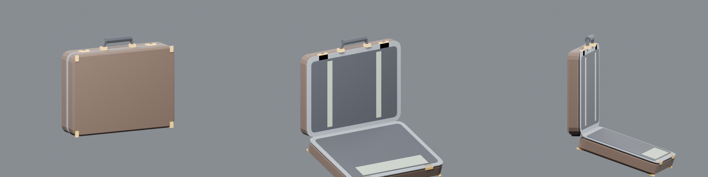

# ブリーフケース（2026-11-06、単独で作成）

194項目の表の21行「ケース本体＋開閉状態＋収納物（収納物は別アイテム）。破壊分解なし」に合わせて、作り直したモデルです。特定の作品のケースではない、一般的な硬いブリーフケースの形です。

- 作り方：`blender -b -P source/build_briefcase.py`。確認画像は `-- --render` で作ります。
- 検証：`node source/validate.cjs`（Khronos glTF validator、エラー0・警告0）
- 840三角形、0.115 × 0.394 × 0.460 m

| 部品 | 内容 |
|---|---|
| 本体（`briefcase_mesh`） | 下側の殻（茶の革）、アルミの縁、内張り（灰）、ゴムベルト2本、足4つ、真ちゅうの錠2つ、取っ手（真ちゅうの台座と革の握り）、底の蝶番 |
| `LID`（動く部品） | 上側の殻、縁、内張り、書類ポケット、留め金2つ、角の金具、蝶番。原点は底の蝶番の線上にあり、glTF のローカル Z で -1.6〜-1.9 回すと開く |
| 印 | `GRIP_R`（取っ手、手で持つ所）、`CONTENT`（中に入れた物が置かれる所）、`HINGE`、`TIP` |

ゲームでは、`app/scripts/embed-items.mjs` がこのモデルを `briefcase` として埋め込みます。古い簡単な版（`assets/items/models/briefcase`）は使っていません。B で銃をしまう・出す時に、蓋が0.9秒ほど開きます。

