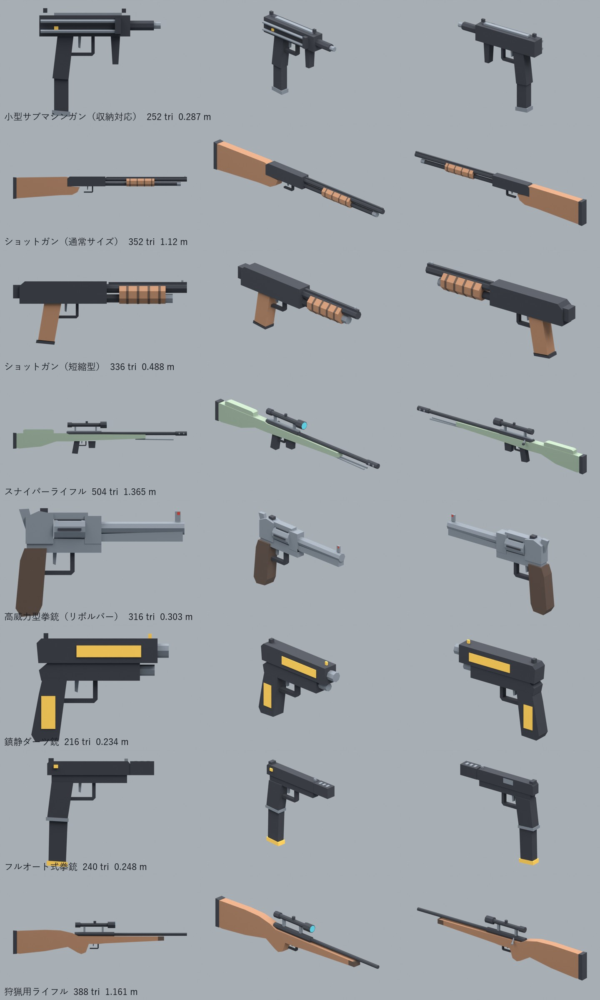

# 銃（簡易版・M5.5 の拳銃と同じ細かさ）

2026-11-06。Claude が作った。**GLB だけ。ゲームにはまだ組み込んでいない。**

- `assets/guns` の8丁（作り込み版）と同じ輪郭・大きさ・印（GRIP_R など）で、M5.5 の `pistol_guard`・`pistol_silenced` と同じ細かさにした版。
- 作り方は M5.5 と同じ：横の形の押し出し、8角の筒、共通の引き金まわり、1丁1メッシュ（動く部品なし）。三角形は約200〜500。
- 作り方：`blender -b -P source/build_guns_simple.py`。証明用の絵：`blender -b -P source/render_guns_simple.py` → `renders/`（`lineup.png` は元の M5.5 の銃と並べた絵）。
- 検証：`node source/validate.cjs`（全部エラー0・警告0）。

