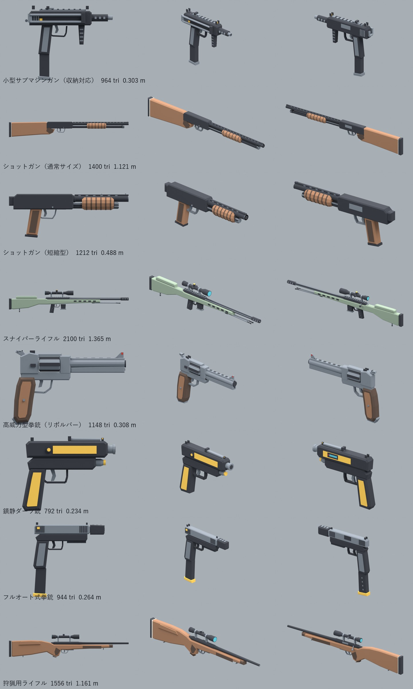
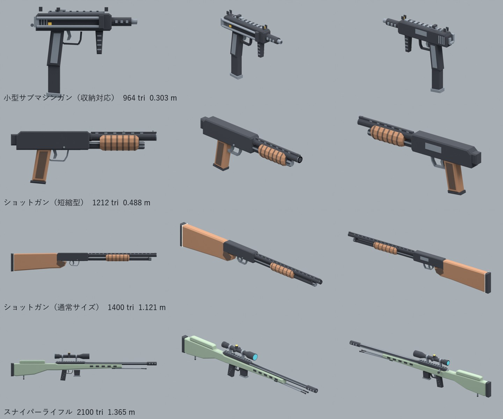
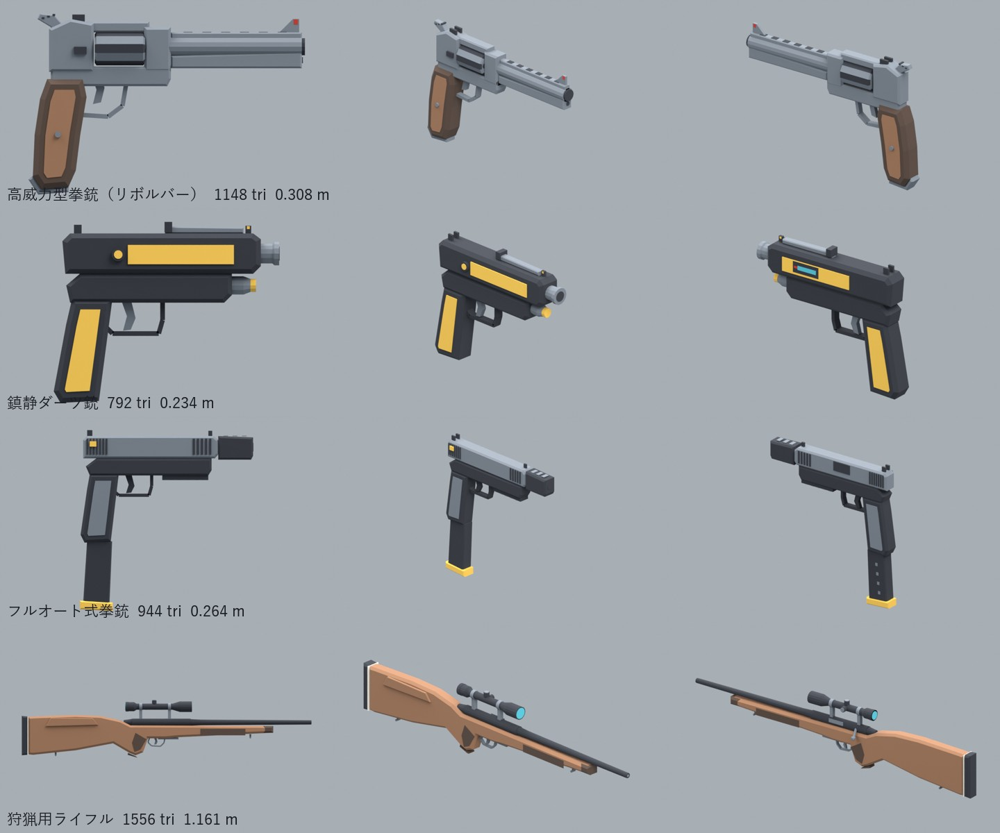

# 銃（一般形のモデル）

2026-11-05 に作り、2026-11-06 に第1弾を作り込み版に作り直した。Claude が作った。**GLB だけ。ゲームにはまだ組み込んでいない。**

- 作り方：`blender -b -P source/build_guns.py`（全部）。名前を付けると1つだけ（例：`-- shotgun`）。`blends/` は確認用。
- 決まりは M5.5 の銃（`../m55-combat`）と同じ：16色パレット、平らな面、roughness 1、1つ1GLB、メートル。
- 向き：右手で握る点が原点（`GRIP_R`）。銃口は +Z。
- 一覧の名前付きの銃（原作のデザイン）は写さず、区分ごとの一般形にした。
- 細かい形の関数は `source/detail.py`（面取りした押し出し、旋盤、溝、ねじ）。
- **動く部品は別の節点**。原点が回転・移動の中心にある（`TRIGGER`、`HAMMER`、`CYLINDER`、`SLIDE`、`MAGAZINE`、`BOLT`、`PUMP`、`LEVER`、`STOCK`、`FOREGRIP`、`BIPOD`）。
- 検証：`node source/validate.cjs`（Khronos glTF Validator。全部エラー0・警告0）。
- 証明用の絵：`blender -b -P source/render_guns.py [-- id ...]` → `renders/`（横・右前・左後ろ、全部の並び `lineup.png`）。

## 第1弾（2026-11-06 作り直し）

| ID | 名前 | 三角形 | 長さ (m) | 印 | 動く部品 |
|---|---|---:|---:|---|---|
| compact_smg | 小型サブマシンガン（収納対応） | 964 | 0.303 | GRIP_R, GRIP_L, MUZZLE | TRIGGER, BOLT, MAGAZINE, STOCK, FOREGRIP |
| shotgun | ショットガン（通常サイズ） | 1400 | 1.121 | GRIP_R, GRIP_L, MUZZLE, STOCK | PUMP, TRIGGER |
| shotgun_short | ショットガン（短縮型） | 1212 | 0.488 | GRIP_R, GRIP_L, MUZZLE | PUMP, TRIGGER |
| sniper_rifle | スナイパーライフル | 2100 | 1.365 | GRIP_R, GRIP_L, MUZZLE, STOCK, SCOPE | BOLT, MAGAZINE, BIPOD, TRIGGER |

- 小型サブマシンガン：プレス鋼の機関部、穴あき銃身カバー、握りの中の弾倉、右へ折れる針金の銃床、折りたたみの前の握り、上のレールと照準器、切り替えレバー（黄）。
- ショットガン：ポンプ式。穴あきリブと2つのビーズ照星、弾の筒とローレット付きのキャップ、溝の入った木の先台（作動棒付き）、赤いリングの安全装置、チェッカリングのある木の銃床、白い線のリコイルパッド、スリングの留め具。
- 短縮型ショットガン：同じ機関部で短い銃身、木のピストルグリップ（チェッカリング、黒いキャップ）、スリングの輪。
- スナイパーライフル：ボルト式。調整できる頬当てとモノポッド付きの樹脂銃床、溝付きの太い銃身と穴あきマズルブレーキ、上のレール、大きなスコープ（3つのつまみ、黄色の目盛り）、着脱弾倉、前へたたんだ二脚。

## 第2弾（2026-11-05、作り込み版）

武器モデル194項目の一覧（`investigation/hitman-woa-weapon-checklist-194-20261105.md`）で、モデルが無かった区分から4つを作った。
- 一覧の名前付きの銃は原作のデザインなので、同じ形は作らない。区分ごとの一般形にした。
- 第1弾より作り込んだ（三角形は約2〜3倍）。
  - 角の面取り、旋盤で削った形の部品（銃身、シリンダー、スコープ）。
  - 溝（スライドのセレーション、シリンダーのフルート、リブの穴）、ねじ、照準器。
  - 色の塗り分け（木、ステンレス、黒、黄色）。
- **動く部品は別の節点**にした。原点が回転・移動の中心にあるので、ゲームでそのまま動かせる。
  - `CYLINDER`、`HAMMER`、`TRIGGER`、`SLIDE`、`MAGAZINE`、`BOLT`、`LEVER`
- 細かい形の関数は `source/detail.py`（面取りした押し出し、旋盤、溝、ねじ）。

| ID | 名前 | 三角形 | 長さ (m) | 印 | 動く部品 |
|---|---|---:|---:|---|---|
| revolver | 高威力型拳銃（リボルバー） | 1148 | 0.308 | GRIP_R, GRIP_L, MUZZLE | CYLINDER, HAMMER, TRIGGER |
| tranq_pistol | 鎮静ダーツ銃 | 792 | 0.234 | GRIP_R, GRIP_L, MUZZLE | LEVER, TRIGGER |
| machine_pistol | フルオート式拳銃 | 944 | 0.264 | GRIP_R, GRIP_L, MUZZLE | SLIDE, MAGAZINE, TRIGGER |
| hunting_rifle | 狩猟用ライフル | 1556 | 1.161 | GRIP_R, GRIP_L, MUZZLE, STOCK, SCOPE | BOLT, TRIGGER |

- リボルバー：大型の6連発、ステンレス。重い銃身と、下の全長ラグ、穴あきリブ。シリンダーは6本の溝と6つの薬室。木のグリップ。
- 鎮静ダーツ銃：ガス式。黒い樹脂に黄色のパネル（殺さない銃だと分かる色）。太い銃口、銃身の下のガスボンベ、装填したダーツが見える窓、圧力ダイヤル。催吐・治療ダーツ銃も、色替えでこの形を使える。
- フルオート式拳銃：樹脂フレームと金属スライド。前後のセレーション、穴あきコンペンセイター、レール、切り替えレバー（黄）、長い弾倉。
- 狩猟用ライフル：ボルト式。クルミ色の銃床（モンテカルロの頬当て、チェッカリング、黒い先台の先とグリップキャップ）、細くなる銃身、狩猟用スコープ、スリングの留め具。

並べた絵（`renders/lineup.png`）は、上から順に次のとおり。
- 拳銃：警備の拳銃、消音ピストル、鎮静ダーツ銃、フルオート式拳銃、リボルバー
- 短機関銃：小型サブマシンガン、短機関銃
- 長物：短縮型ショットガン、突撃銃、ショットガン、狩猟用ライフル、スナイパーライフル
