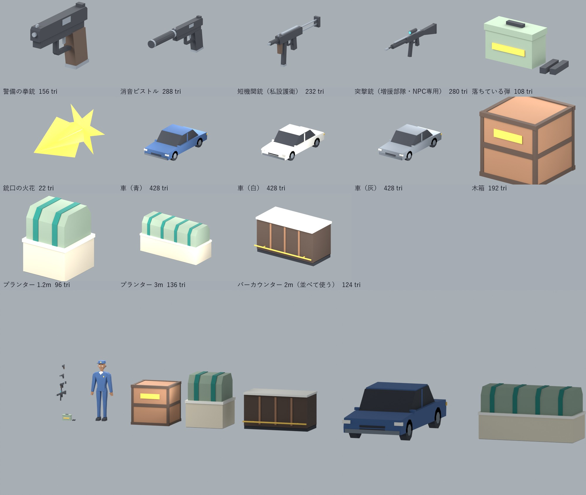
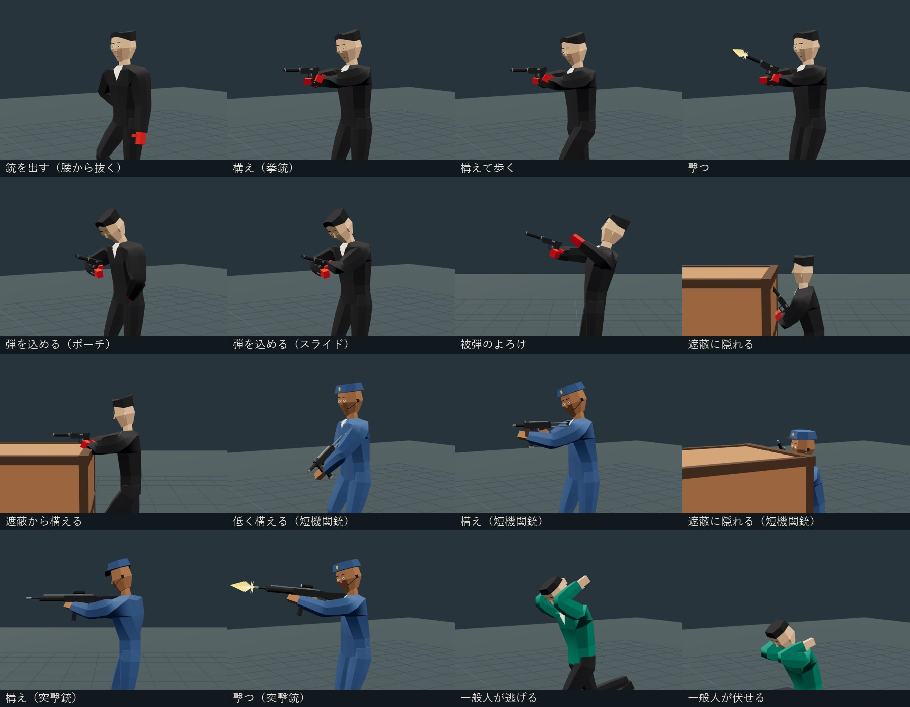

# M5.5 撃ち合い用の3Dモデル

M5.5「銃と撃ち合い」で使う武器・弾・銃口の火花と、撃ち合い用の遮蔽物（車・木箱・プランター・カウンター）。M5実装ガイドの「素材とテスト項目」と weapons.json / combat.json の項目に合わせた。ゲームへの組み込みはまだしていない（5.5の作業）。



## 作り方

- 既存のキャラクター（character-revision）と同じ16色パレット1枚（256×256、4×4マス、[palette.png](palette.png)）。平らな面、roughness 1、法線マップなし。1モデル1GLB。
- 単位はメートル。glTFでY上・+Z前。銃は銃口が+Zを向く。
- 部品どうしは数mm重ねて組み、同じ平面で面が重なる所は作らない。
- 生成は [source/build_m55_assets.py](source/build_m55_assets.py)。手で編集したモデルはない。`blends/` は確認用。

## 一覧

| ID | 内容 | 三角形 | 大きさ X×Y×Z (m) | 印（空ノード） |
|---|---|---:|---|---|
| pistol_guard | 警備の拳銃（グリップ茶） | 156 | 0.031 × 0.146 × 0.198 | GRIP_R, GRIP_L, MUZZLE |
| pistol_silenced | 消音ピストル（主人公、黒） | 288 | 0.033 × 0.146 × 0.358 | GRIP_R, GRIP_L, MUZZLE |
| smg | 短機関銃（私設護衛） | 232 | 0.042 × 0.254 × 0.600 | GRIP_R, GRIP_L, MUZZLE, STOCK |
| rifle_npc | 突撃銃（増援部隊・NPC専用、他の銃と同じ黒） | 280 | 0.048 × 0.296 × 0.930 | GRIP_R, GRIP_L, MUZZLE, STOCK |
| ammo_pickup | 落ちている弾（弾薬箱＋マガジン2本） | 108 | 0.398 × 0.185 × 0.159 | PICKUP |
| muzzle_flash | 銃口の火花（両面・自己発光） | 22 | 0.090 × 0.078 × 0.140 | MUZZLE |
| car_sedan_blue / _white / _grey | 車（色違い3台） | 428 | 1.900 × 1.421 × 4.400 | COVER_FRONT/BACK/LEFT/RIGHT |
| crate | 木箱 | 192 | 1.200 × 1.200 × 1.200 | 同上 |
| planter_1x1 | プランター 1.2m | 96 | 1.200 × 1.572 × 1.200 | 同上 |
| planter_3x1 | プランター 3m | 136 | 3.000 × 1.572 × 1.200 | 同上 |
| counter_bar_2m | バーカウンター 2m（並べて使う） | 124 | 2.000 × 1.100 × 1.082 | 同上 |

大きさと印の座標は、書き出したGLBを読み直して測った値（[measured.json](measured.json)）。

### 印の使い方

- **GRIP_R**：右手で握る位置。銃の原点。手の骨にこの点を合わせ、銃口（+Z）を前へ向ける。
- **GRIP_L**：左手（支える手）の位置。拳銃は両手持ち用。
- **MUZZLE**：弾と火花が出る位置。`muzzle_flash` の原点をここに置く。
- **STOCK**：肩に当てる位置。
- **COVER_\***：遮蔽物の各面から0.45m外の床。NPCとプレイヤーが隠れる位置の候補。
- **PICKUP**：拾う判定の中心。

### 5.1の当たり判定との対応

| モデル | 5.1の箱 (幅×奥行×高さ) | 備考 |
|---|---|---|
| 車 | 1.9 × 4.4 × 1.4 | 足元を合わせた。屋根は1.42m |
| 木箱 | 1.2 × 1.2 × 1.2 | 一致 |
| プランター | 1.2 × 1.2 × 0.9〜1.0、3 × 1.2 × 1.0 | 植え込みの上端1.55mは、ゲームで視線を遮る高さ（箱＋0.65m）に合わせた |
| カウンター | 8 × 1.2 × 1（厨房）、1 × 9 × 1.1（バー）など | 2m単位で並べる。足かけの棒だけ手前へ0.08m出る |

## 撃ち合いのモーション



仕様の「撃ち合い」と「一般人」のアニメーションを、既存のM3/M4と同じ手続き型（22本の骨の角度をキーで並べる）で作った。キーフレームのファイルはなく、コードが毎フレーム姿勢を計算する。

| 動き | 種類 | 長さ |
|---|---|---:|
| 銃を出す / しまう | 拳銃は右腰から抜く（主人公は上着の下に隠す）。長い銃は低い構えから上げる | 0.7秒 |
| 構え（構えて歩く） | 呼吸で数mm揺れる繰り返し。上半身だけなので、歩き・走りの脚と重ねられる | 3秒ループ |
| 撃つ | 反動で銃口が跳ね、胸と頭が少し下がる | 0.25秒 |
| 弾を込める | 左手が弾倉→左腰のポーチ→弾倉→スライド（長い銃は槓桿）→構えに戻る | 1.8秒 |
| 被弾のよろけ | 全身。上体がのけぞって後ろへ下がり、構え直す | 0.6秒 |
| 遮蔽に隠れる / 遮蔽から構える | 右ひざをついてしゃがむ（1.2mの木箱に隠れる）→ 半分立って木箱の上から構える | 3秒ループ / 0.5秒 |
| 一般人が逃げる / 伏せる | 走りに重ねて腕で頭を守る / しゃがんで頭を覆い、震える | 0.8秒ループ / 1.2秒 |

- **銃の持ち方**：銃の位置は体の正面を基準にした座標で決め、両手は既存のIK（`motion-runtime.ts` の `reach`）で銃の印（GRIP_R / GRIP_L）へ合わせる。体型の設定が変わっても手が離れない。
- **コード**：`app/src/combat-motion.ts`（姿勢と銃の位置）、`app/src/combat-runtime.ts`（骨と銃への当てはめ、`layerUpper` で歩きに重ねる）。ゲームへの組み込みは5.5の作業。
- **確認用ページ**：`combat-motions/index.html`（`http://127.0.0.1:8768/m5-prototype/combat-motions/index.html`）。人・動き・歩きながら・速度・視点を切り替えられる。作り直しは `app` で `node scripts/embed-combat.mjs` → `node scripts/build-combat-lab.mjs`。
- **検証**：`node scripts/verify-combat.mjs`。主人公・警備員・私設護衛・増援 × 8動作（歩きあり・なし）の52通りを101時点ずつ動かし、手と銃のずれは最大1.51cm、コンソールエラー0（`combat-motions/verify.json`、画像は `combat-motions/proof/`）。Nodeテスト `tests/combat-motion.test.ts` 7件（値の範囲・つながり・ループの閉じ方・持ち替え時に手を離すこと・遮蔽の高さ）。
- **調整したこと**：突撃銃は構えたときに左手が届かなかったため、肩当てを7cm短くし（全長0.93m）、左手の位置を弾倉の前へ寄せた。

## 確認したこと

- **公式 Khronos glTF Validator**：13点すべてエラー0・警告0（[khronos-validation.json](khronos-validation.json)）。情報表示は、印の空ノードについての NODE_EMPTY だけ。
- **Blenderで読み直して描画**：書き出したGLBを空のシーンへ読み直し、Astraと同じ照明（Cycles 32サンプル、3灯）で各4方向を描いた（`renders/`）。
- **大きさ**：警備員のモデル（1.8m）と並べた画像（`renders/lineup-with-guard.png`）と、手に持たせた画像（`renders/hand-check-*.png`）で確かめた。手に持たせた画像は位置だけ合わせたもので、握る向きの調整はしていない。

## まだ確認していないこと

- ゲーム本体（main.ts）への組み込みと、120人＋撃ち合い中のfps。three.jsでの表示と手への取り付けは確認用ページで確かめた。
- 増援部隊の人のモデル、効果音は作っていない。モーションの手の向き（握り方の角度）と指はIKで合わせておらず、位置だけを合わせている。

## 作り直し

```powershell
& 'C:\Program Files\Blender Foundation\Blender 4.2\blender.exe' -b -P source\build_m55_assets.py
& 'C:\Program Files\Blender Foundation\Blender 4.2\blender.exe' -b -P source\render_assets.py
node source\validate.cjs
python source\make_sheet.py
```

1点だけ作り直すときは `build_m55_assets.py -- smg` のようにIDを渡す。
