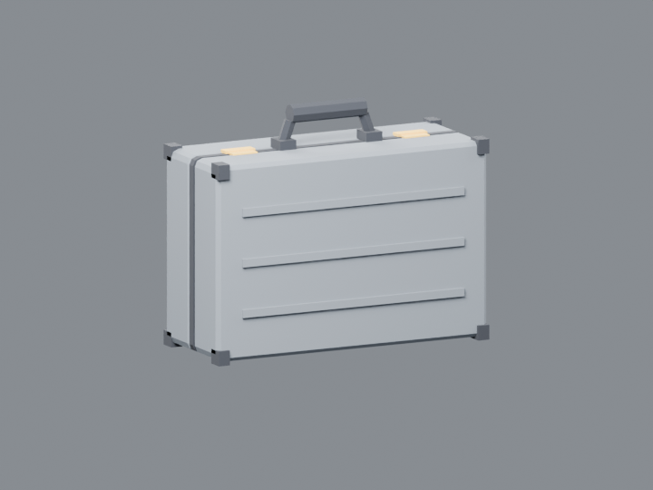
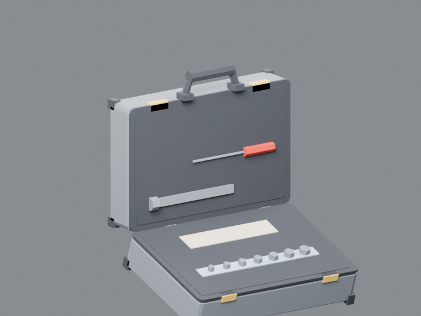

# 工具箱型ケース（2026-11-07、HD12）

194項目の表の22行「工具箱型ケース」に合わせて作ったモデルです。ブリーフケースと同じ作り方で、ゲームでも同じように扱います。特定の作品の物ではない、一般的なアルミの工具ケースの形です。

- 作り方：`blender -b -P source/build_toolbox.py`。確認画像は `-- --render` で作ります。
- 検証：`node source/validate.cjs`（Khronos glTF validator、エラー0・警告0）
- 1004三角形、0.18 × 0.366 × 0.44 m

| 部品 | 内容 |
|---|---|
| 本体（`toolbox_mesh`） | 下側の殻（アルミ、横の筋3本）、黒い縁と角の金具、内側のスポンジ、スパナとドライバー、足4つ、留め具2つ、取っ手、底の蝶番 |
| `LID`（動く部品） | 上側の殻、縁、筋、角の金具、ソケットの列、部品の小箱、留め金2つ、蝶番。原点は底の蝶番の線上にあり、glTF のローカル Z で -1.6〜-1.9 回すと開く |
| 印 | `GRIP_R`（取っ手）、`CONTENT`（中に入れた物の位置）、`HINGE`、`TIP` |

ゲームでは `app/scripts/embed-items.mjs` が `toolbox` として埋め込みます。クラブの搬入口に置いてあり、I で銃を1丁しまう・出す時に蓋が開きます。

 
