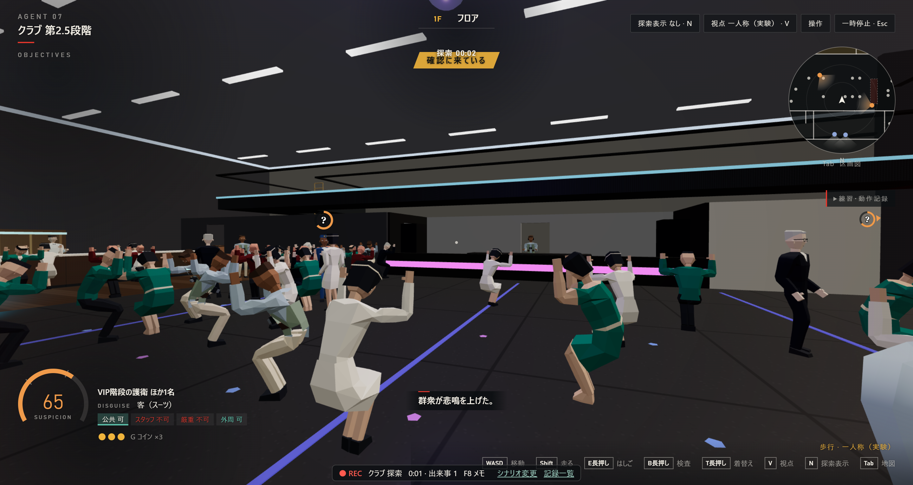

# クラブ第2.5段階の再修正

## 性能

表示ありの Chrome 156、1440×765、端末の表示倍率2で測った。描画は AMD Radeon のハードウェアを使用。ビルドと試験を終えてから、検証用プロファイルで各版を1タブずつ測った。既に起動していた別のChromeは閉じていない。測定中に確認したCPU使用時間の増加は小さかった。

|版|入口 中央値 / 下位5%|フロア 中央値 / 下位5%|
|---|---:|---:|
|第2段階|58.2 / 55.6 FPS|74.5 / 73.0 FPS|
|群衆の修正前|54.3 / 51.2 FPS|66.1 / 63.1 FPS|
|前回の群衆修正後|51.8 / 49.7 FPS|63.0 / 61.4 FPS|
|今回の再修正|60.2 / 58.8 FPS|73.2 / 69.4 FPS|

最終ビルドを別に測り直した結果は、入口71.0 / 65.2 FPS、フロア85.0 / 80.2 FPS。どちらの測定でも中央値47 FPSを上回った。[最終ビルドの再測定](club-crowd-fix2-final.jsonl)

前回修正で入口の描画呼び出しは500から509回に増えた。描く三角形は74,361から76,675枚に増えた。同じ視点での速度低下は約3 FPS。人の記録にあった47→23〜25 FPSの半減は再現せず、原因は特定できなかった。

入口の切り分けでは、前回修正版の中央値58.1 FPSに対し、`debug.js` の視線判定を包む処理を外すと58.4 FPS。群衆による視線のさえぎりを止めると44.8 FPS。群衆を0人にすると描画は43,692枚減ったが、中央値は49.6 FPSだった。この測定では、いずれを外しても半減を説明できる改善は出なかった。平常時の群衆は、毎フレームの位置の作り直しを元から行っていなかった。

今回の修正では、群衆モデルの重複した頂点を共有した。群衆の位置や姿勢が変わった組だけ、描画用の位置を更新する。視線判定は群衆のまとまり単位で行い、範囲が重ならないまとまりを先に除く。3D描画の倍率上限を1.75から1.5に下げた。描画面は2520×1338から2160×1147になり、画素数は約27%減った。画面表示の倍率は端末の2のまま。iPad第9世代の実機は未測定。

### 測り方

1. `m5-prototype` で、比較用の [3版のHTML](club-crowd-fix2-baselines.zip) を別のフォルダーに展開する。
2. ビルド、試験、負荷の高いタブを止める。下のコマンドを実行する。引数のHTML名は展開先へのパスに置き換える。

   ```powershell
   node investigation/club-crowd-fix2-performance.mjs clean-hands-club-stage2-20261103.html club-crowd-before-fix.html club-crowd-first-fix-20261103.html club-prototype.html
   ```

3. ゲームを前面にしたまま待つ。道具が「作戦開始」を押し、表通り（22, 2）とフロア（22, 17）で視点を固定する。各点で2秒待ち、次の16秒間を測る。表は、プレイ記録と同じゲーム内のFPS表示を毎秒読んだ値。各フレームの間隔も出力する。試しの記録は `meta.test=crowd-qa` を付け、測定用のサーバー内で破棄する。

[4版の測定値](club-crowd-fix2-performance.jsonl) · [切り分けの測定値](club-crowd-fix2-diagnosis.jsonl)

## 群衆

メモ `143246` の130.6秒では、群衆の縦寸法を0.66倍にしていた。膝と腰を曲げて腕を上げる姿勢に差し替えた。身長と体幅の倍率は、立っているときと同じ。写真はフロアで銃声に反応した約2秒後。



## 検査と銃

- `143131` では、入口の線（z=6）で落とした消音ピストルを、17.37秒に内側（x=21.99、z=6.55）から拾えた。今は検査済みでも、線の反対側にある銃や道具は拾えない。
- 警備は床の銃が視界に入ると、近づいて回収する。検査役が回収に向かう間も線は有効。銃を拾うところを警備に見られると疑いが上がる。
- 表通りと建物の境（z=6）を5 cm刻みで確認した。歩ける開口は正面（x=21.10〜22.90）の1か所。検査役が持ち場にいる状態で、銃を持ったまま渡れる点は0。喫煙所から裏路地・搬入口へは行けるが、表通り側の柵に開口はない。[経路の調査スクリプト](club-weapon-route.ts)
- **G** で投げられるのはコイン。銃を壁越しに投げ入れる操作はない。既存の判定では、検査役が持ち場を外れると正面を通れる。建物内では事務所の金庫（x=16.5、z=31.5）から警備の拳銃も手に入る。

## 確認

- `npm test` は314件成功、失敗0件。ホテル・夜会の試験を含む。依頼どおりゴーストの通し試験は `NODE_OPTIONS='--test-skip-pattern="[Ww]alking ghost"'` で除外した。追加した3件は、検査済みの線越し取得、警備の回収、目撃時の疑いを確認した。[試験出力](club-crowd-fix2-tests.txt)
- `npm run check` は成功。クラブのビルドと単体HTMLの生成も成功。表示ありのChromeで作戦開始と群衆の姿勢を確認し、エラーは0件だった。
- Chromeで表通りから入口まで歩いた。**Q長押し**で消音ピストルを捨て、警備が回収した後に**B長押し**で検査を受けた。線の内側（x=22、z=6.61）で**E**を押しても、銃の所持数は0だった。ブラウザエラー0件。
- 主な変更は `app/src/club/` の群衆・武器処理、クラブの設定と生成元、取得範囲を渡す共通部品、クラブの試験、`club-prototype.html`、README、測定資料。
