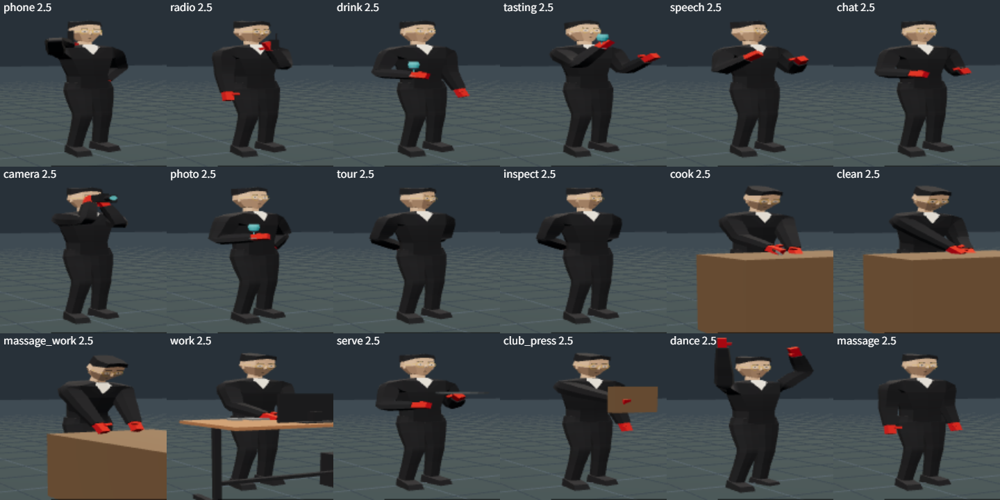
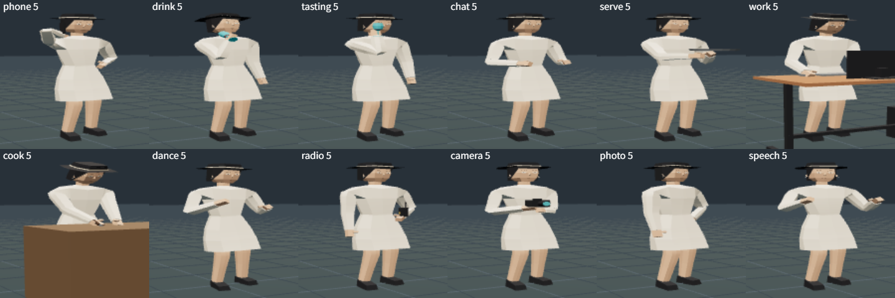

# 予定の仕草の作り直し

2026-11-05。Claude が作った。

## 1. 前の問題

前の `schedule-motion.ts` は、仕草ごとに腕の振りの角度とひじの曲げを1つ決め、正弦波で揺らすだけだった。そのため、次のことが起きていた。
- 手が、どこにも届いていなかった（電話が耳に、グラスが口に、手が机に届かない）。
- 「飲む」は、ずっと腕が上下するだけだった。段階（グラスを持つ → 口へ運ぶ → 下ろす）がなかった。
- 小物がほとんどなかった（電話はターゲットだけ、グラスやトレイはなし）。
- 仕草の始まりと終わりで、姿勢が一瞬で切り替わった。

## 2. 新しい作り（`app/src/gestures.ts`）

仕草ごとに、2つの層で作る。
1. **体**：呼吸、ゆっくりした重心の移動、背中・頭・腕のおおよその形。
2. **手**：手首の行き先を、その人の体の位置（メートル）で決める。腕2本の骨の IK で届かせる。ひじの向き（外・下など）も指定する。

ほかに、次の仕組みを入れた。
- **段階**：「グラスを持つ → 時々口へ運ぶ」「話す番と聞く番」「刻む → 鍋をかき混ぜる」のように、時間で段階が変わる。段階の間は、なめらかに混ぜる。
- **ばらつき**：段階の長さや、どちらの手を使うかは、周期ごとに変わる。人ごとに時間がずれているので、同じ部屋の人がそろって動かない。
- **小物**：手首について行き、向きは人の向き（上・前）で決める。グラスは立てて持ち、飲む時は口へ傾ける。トレイは水平。無線機はアンテナを上。電話は画面を顔に向ける。
- **入る・出る**：立ち止まって仕草を始める時、やめて歩き出す時、別の仕草に移る時は、0.5秒かけて混ぜる（`GesturePlayer`）。小物は、仕草が6割以上入ってから出る。

## 3. 18の仕草

| 仕草 | 手の動き | 小物 |
|---|---|---|
| 電話 | 右手で耳に当てる。ひじは外下。左手は腰か下げる。時々、左手で話に合わせて手振り。聞く時はうなずく | スマートフォン |
| 無線 | 左手で低く持つ。数秒ごとに口元へ上げて話し、顔を向ける | 無線機 |
| 飲む | 胸の前でグラスを持つ。数秒ごと（ばらつきあり）に口へ運び、頭を少し反らして飲む | グラス |
| 試飲 | 光にかざして見る → 回す → 香りをかぐ → 少し飲む。低い時は左手を添える | グラス |
| 談笑 | 話す番は両手で腰の高さの手振りとうなずき。聞く番は前で手を軽く組み、時々うなずく | — |
| スピーチ | 胸の高さで手を開いて大きく動かす。頭と胸で会場を見回す | — |
| 撮影 | 両手でカメラを目に当てる。撮影の合間は胸まで下ろして見回す | カメラ |
| 記念撮影 | 体を少しひねり、左手を腰に。数秒ごとに向きを変える。グラスを持つ時もある | グラス |
| 見学 | 手を後ろで組み、ゆっくり見回す | — |
| 点検 | 見学と同じ。時々、身を乗り出して指差す | — |
| 料理 | 左手で押さえ、右手で包丁を刻む。合間に右手で鍋をかき混ぜる。少し前かがみ | 包丁 |
| 掃除 | 右手で台を円を描いて拭く。左手は縁に。時々、拭く場所を移る | — |
| 施術 | 両手で台を交互に押す。体重をかけて前かがみ | — |
| 仕事 | 立ち机のキーボードを打つ。時々、右手でマウス、書類を見る | （立ち机とパソコンの前で） |
| 給仕 | 左の手のひらでトレイを肩の高さに水平に持つ。時々、右手でグラスを差し出す | トレイ |
| ボタンを押す | 前のボタンに手を伸ばし、押して止める。ボタンを見る | — |
| ダンス | 125BPM で弾む。腰と胸を逆にひねる。腕を交互に上下。数小節ごとに両手を上げる | — |
| マッサージを受ける | 寝ている（体は `npc-view.ts` で倒す）。腕は体に沿わせて楽に。ゆっくり呼吸 | — |

パーティーの「talk」は、談笑と同じ仕草にした（前は何も動かなかった）。

## 4. 新しく作ったモデル

`assets/props/`（README あり）。Blender で、銃や道具と同じ作り方で作った。Khronos の検証はすべてエラー0・警告0。
- スマートフォン、ワイングラス、無線機（手に持つ物）。
- 立ち机とパソコン（天板0.95m、モニター、キーボード、マウス、書類、PC 本体）。

立ち机は、今はモーション実験ステージで「仕事」の前に置いて確かめるのに使っている。**マップにはまだ置いていない。** クラブで「仕事」をする場所は、事務所（机とノートPCがある）、DJブース、機材室、バー倉庫、キャットウォーク。置くなら、何もない機材室・バー倉庫が候補。

## 5. どこに効くか

- **NPC**：`npc-view.ts` は全マップ共通なので、クラブ・ホテル・パーティーの NPC すべてに入る。
- **プレイヤー**：クラブ（共通エンジン）で、仕事の場所に溶け込んだ時に同じ仕草をする。
- 古いホテルとパーティーの写しでも、NPC には入る。小物を出すために、モデルの読み込みを1行足した。プレイヤーが溶け込む時は、体の層だけ（前と同じ呼び方）。
- モーション実験ステージの「予定の仕草」は、この新しい仕草を出す。「仕事」「料理」「掃除」「施術」「ボタンを押す」は、前に机・台・パネルを置く。

## 6. 確かめ方

- モーション実験ステージ（`http://127.0.0.1:8795/animation-lab`）で再生する。画面を使わずに確かめるための関数も足した。
  - `__animLab.poseAt(id,秒)`：その時刻のポーズにする。
  - `__animLab.view(角度,距離,高さ,見る高さ)`：カメラを動かす。
  - `__animLab.joints(...)`：関節の位置を出す。
  - `__animLab.sheet([...])`：一覧の絵を作る。
- 試験 `tests/gestures.test.ts`（21件）。
  - 前の18の仕草がすべてあること。
  - どの仕草も40秒の間、手が1コマで5cm以上（秒速3m以上）動かないこと、手の重みが急に変わらないこと、背中と頭が飛ばないこと。
  - 入る・出る・別の仕草へ移る時に、腕が飛ばないこと。
- 全体の試験：377件すべて通過。
- 18の仕草を、エージェントと女性客の NPC で絵にして確かめた（この文書の絵）。

## 7. まだのこと

- 手首と指の向き：IK は腕の位置を合わせるだけで、手首はまっすぐのまま。
- 座る仕草（クラブのラウンジの「sit」41件、パーティーの「read」）は、今回の対象外。今も別の仕組み（群衆）か、立ったまま。
- 立ち机をマップに置くこと。
- 実際にゲームを遊んでの確認。画面が隠れていたので、ゲームの中で動く様子は見ていない（クラブが読み込めて、エラーがないことだけ確かめた）。
