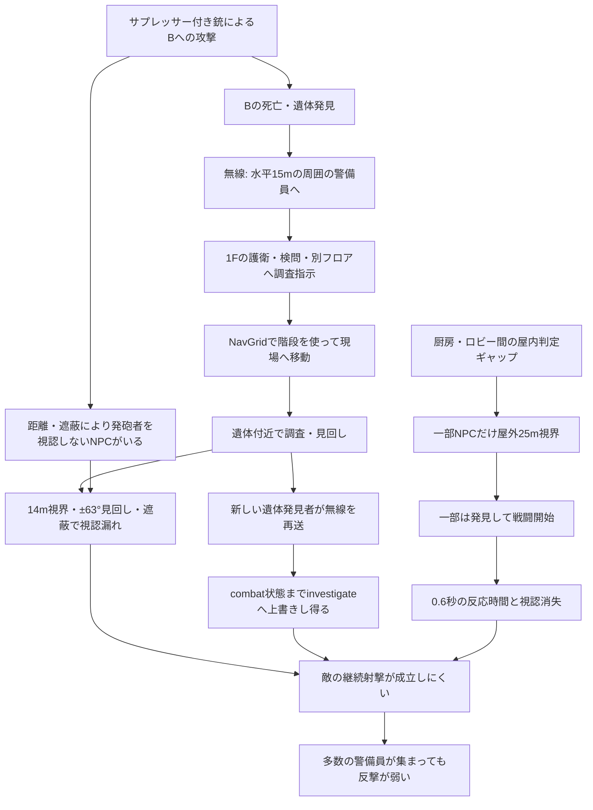

# CLEAN HANDS ホテルステージ：AI認識・捜索・戦闘不具合 総括調査報告書

**調査日：** 2026年11月4日  
**対象：** `CLEAN HANDS` ホテルステージ（M5.8のモバイル録画／旧HTMLの無描画実行／Git版TypeScript）  
**対象リポジトリ：** `stupidsavacan/clean-hands`  
**コード基準：** `main` — commit [`81bae670e16658fb160106a146757b269568befe`](https://github.com/stupidsavacan/clean-hands/commit/81bae670e16658fb160106a146757b269568befe)（コミット日時 2026-11-03 07:02:29 UTC）  
**目的：** 「ターゲットBの遺体へ警備員が続々と集まる一方、発砲者への対応が弱く、警備員9人が倒されても被弾が2発にとどまる」現象の発生機序を特定し、修正可能な仕様・テストに落とす。

> **重要な区別：** 録画はユーザーが実際に操作した**旧M5.8版**。無描画実験も同HTMLに手を加えたもので、**現行Git版の完成ゲームをそのまま走らせた結果ではない**。一方、数値・条件分岐・問題のコードは上記Gitコミットのソースで確認している。映像・旧エンジンの再現・Gitコードの3種類の証拠を混同しない。

---

## 1. エグゼクティブサマリー

### 結論

本現象は「NPCの目が悪い」という単一問題ではない。**遺体報告による集結は正常に進むのに、現場でのプレイヤー認識・戦闘維持・状況の優先順位が連携していない**ことが本質である。主要因は以下の複合である。

1. **発砲と発見の非対称性：** プレイヤー銃撃は60mを基本とするHitscan判定で、コード上は60mを厳密な上限としていない。一方、屋内警備員の視認距離は14m、消音銃声の基本検知距離は8m。射撃は成立しても発砲者が判明しない位置関係が生じる。
2. **遺体発見→無線→集合：** 犯人不明の遺体が発見されると、水平15m以内の警備員へ調査指示が配信される。上下階へのフィルターがなく、2Fの客室廊下警備員・RFの屋上警備員も呼ばれる。経路探索が階段移動を実際に行う。
3. **調査時の視認制約：** 護衛3人が遺体近くで見回しても、植え込み付近のプレイヤーまで約16〜17mあり、屋内14mの視認範囲外である。見回し角度も全周ではなく、建物や植え込みは視線を遮る。
4. **屋内・屋外判定の穴：** 厨房とロビーの間の幅2mの領域は `rooms` の屋内範囲外。そこにいるNPCは屋外用25mの視認距離になり、別方向から接近したNPCだけが遠くから発見できる条件を生む。
5. **状態遷移の不整合：** `Npc.radio()` は `combat` 状態を保護せず、遺体報告で `investigate` に上書きできる。新しい発見者が同一遺体を報告し直すたび、この割り込みが起こり得る。旧エンジンでも状態上書きの単体再現を確認した。
6. **短い反撃機会：** 敵の射撃には視認継続と0.6秒の反応時間が必要。部分視認時は命中率が半分になる。消音ピストルの頭部ダメージは150で、通常警備員HP100・私設護衛HP150を1発で倒せる。

**優先度：** `radio()` による `combat → investigate` 上書きと、屋内判定領域の欠落を **P0** とする。視野角だけを一律に広げる修正は推奨しない。

### 確実性の凡例

| 記号 | 意味 |
|---|---|
| **[V]** | ユーザーの録画・リザルトで確認 |
| **[C]** | Git版のコード・設定値で確認 |
| **[S]** | 旧M5.8の無描画実行、または数式再現で確認 |
| **[I]** | 複数の根拠から整合する推論。個別NPCの実行時ログなし |
| **[U]** | 未確認・断定不可 |

---

## 2. 調査資料・実験条件

| ソース | 内容 | 証拠としての限界 |
|---|---|---|
| **[V]** `ScreenRecording_11-04-2026 15-38-21_1.mp4` | モバイル実操作、約78.24秒。撃破通知、リザルト、現場に集まるNPC、途中の戦闘発生を確認 | NPCの正確な座標、`state`、`visibility`、無線の送受信は記録されない |
| **[S]** `CLEAN_HANDS_TargetB_原因検証_実行記録.json` | 旧M5.8でBの死亡と遺体発見を強制注入し、描画なしでNPCを追跡 | 発砲者の銃声処理を発生させない実験。実銃撃を完全再演したものではない |
| **[S]** `target_b_first_detection_trace.json` / `target_b_counterfactual_14m.json` | プレイヤー固定で最初の視認者を追跡し、屋外視認25mと14mを比較 | 他の条件・NPC移動タイミングが異なる可能性があり、録画と1対1対応しない |
| **[V]+[I]** `CLEAN_HANDS_録画_行動マップ_解析データ.json` | 撃破通知による個体識別・時系列と初期配置、推定移動方向 | 移動経路の線は推定。未特定の警備員1人を含む |
| **[S]** `clean_hands_security_chief_headless_results.json` | 警備主任への背後アクションと検問担当の視認を189条件で計算 | ゲーム全体ではなく、AI/M3式を使った部分移植シミュレーター |
| **[C]** Git `main` の `.ts` および `.json` | 現行の分岐・定数・ステート遷移 | この調査でGit版の全TypeScriptテスト・完全なブラウザゲームは実行していない |

**代表的なB追跡実験の条件：** プレイヤー `(x=13.5, y=0, z=-17.6)` に固定、B初期位置 `(-2, 0, -11)`、Bを `deathKind='murder'` で死亡扱いにして遺体発見を発火、A・Cの逃走処理停止、その他NPCのAI・地形・ナビは原則動作。**この試験ではサプレッサー音 `small` の発砲自体を行っていない**。音がなくても上階出動が起きるかを分離する実験である。

---

## 3. 実録画の時系列とリザルト

### 3.1 倒れた順序（映像で識別できた事象）

| 通し番号 | 録画時刻（概数） | 事象／NPC | 個体同定 |
|---:|---:|---|---|
| 1 | 11.2秒 | ホテル警備員を気絶させ、変装につながる | 個体ID不明。**死亡ではない** |
| 2 | 28.5秒 | **B：元顧問弁護士 `lawyer`** を消音ピストルで倒す | 高 |
| 3 | 34.1秒 | 招待客1人を倒す | 役割のみ |
| 4 | 35.7秒 | 護衛隊長 `bodyguard_captain` | 高 |
| 5 | 41.8秒 | 私設護衛・1人目 | `bodyguard_1` / `_2` の順は不明 |
| 6 | 44.1秒 | 私設護衛・2人目 | 同上 |
| 7 | 46.2秒 | 大階段の検問担当 `guard_check_lobby` | 高 |
| 8 | 52.2秒 | 2F・客室廊下 `guard_corridor` | 高 |
| 9 | 64.0秒 | プール `guard_pool` | 高 |
| 10 | 64.8秒 | テラス `guard_terrace` | 高 |
| 11 | 66.7秒 | RF・屋上 `guard_heliport` | 高 |

**[V] リザルト：** 警備員の排除 **9人**、ターゲット以外の排除 **1人**、撃ち合い **2回**、プレイヤー被弾 **2発**。最後はターゲット逃走によりミッション失敗。**被弾2発とは命中した弾数であって、敵の総発射弾数ではない。**

**[U] 個体数の差分：** 名前を識別できる警備員の撃破通知は8人分で、リザルトは9人。**残り1人の個体IDと正確な時刻は未特定。** 上表は「特定できた事象の順序」であり、未特定1人をどこかに無理に挿入していない。序盤の気絶は `guard_kill` に含まれない（`score.ts` の `npc.killed` 判定）。

### 3.2 映像から言えること／言えないこと

- **[V]** 28〜30秒：Bへの攻撃後、「死体が発見された」の表示が出る。
- **[V]** 34秒頃と50秒頃：戦闘開始が表示され、**一部の敵は実際にプレイヤーを認識している**。全NPCが常に見失っているという説明は誤り。
- **[V]** 42秒頃：「見失わせた。…潜入に戻れる」という趣旨の表示。周囲にNPCがいる中でも戦闘終了判定が成立した。
- **[V]** 以降も別方面から警備員が来るが、現場で連続して倒される。
- **[U]** 護衛の視認値が各フレームで厳密に0だったか、誰が最初に無線を出したか、2回の戦闘の全参加者、警備員の発射弾数は録画だけでは不明。

---

## 4. 直接の原因①：射撃・銃声・視認の非対称性

### 4.1 現行の主要定数

| 項目 | 値 | 根拠 |
|---|---:|---|
| プレイヤー銃撃の基本射程 | 60m | `data/combat.json` の `range` |
| 消音ピストルのダメージ | 50 | `data/weapons.json` |
| 消音ピストルの頭部倍率 | 3倍（150ダメージ） | 同上 |
| 消音ピストル銃声の検知上限 | 基本8m | `data/combat.json` の `noiseSmall` |
| 遮蔽物越しの消音銃声 | 基本4m相当（同階で遮蔽時） | `noiseWallFactor = 0.5`、`combat.ts` |
| 屋内警備員の通常視界 | 14m、左右50° | `data/rules.json` |
| 屋外警備員の通常視界 | 25m、左右50° | `data/rules.json` |
| 近距離の周辺視野 | 3.5m、左右95° | `data/rules.json` |
| 接触距離の判定 | 1.1m | `data/rules.json` |
| 視認更新間隔 | 近距離・高優先度で通常約10Hz、遠め約2Hz | `ai.ts` のLOD処理 |
| 通常警備員HP／私設護衛HP／増援HP | 100／150／200 | `data/combat.json` |
| 敵が視認してから発射可能になるまで | 0.6秒 | `data/combat.json` |

**[C] 実装上の射程に関する問題：** `CombatSystem.fire()` が当たり判定の探索長に `Math.max(this.rules.range, len + 1)` を使用するため、照準点までの長さ `len` が60mを超えれば60mを超えて探索する。さらに `sightHit()` が `range + 8`（68m）まで照準レイを探索する。よって「60mで必ず当たり判定終了」という厳密な上限にはなっていない。ただし**無限遠まで撃てるという意味ではない**。照準点・カメラ位置・壁で実効距離は変わる。

**[C] サプレッサーの意味：** `pistol_silenced` は `noise: 'small'`。`canHearGunshot()` は「発砲音が届いたか」のみを判定し、銃声だけで犯人の身元を確定しない。別フロアでは検知距離がさらに縮む。

### 4.2 なぜBを倒せても護衛に見つかりにくいのか

- 植え込み `planter-lobby` 中心：`(12.6, -17.6)`。
- B `lawyer` 初期位置：`(-2, -11)`。
- **植え込み中心からB初期位置まで約16.02m**。追跡実験で固定したプレイヤー `(13.5, -17.6)` からBまで約16.85m。
- **[S]** Bの遺体発見直後、護衛隊長・私設護衛2人からプレイヤーまで約 **17.35m / 16.31m / 16.86m**。全員、通常の屋内14mの外にいたため `visibility=0`。
- **[C]** `ai.ts` の `perceive()` は距離・視野角に入った場合だけ、プレイヤーの頭・胴・脚方向へ3本の視線レイを飛ばす。`sight.ts` は植え込みを見通せないボックスとして扱い、`planter-lobby` 高さ0.9mにヘッジ0.65mを加え、**合計1.55m**の視線障害物にする。
- **[C]** `m3.ts` の遺体発見判定は、プレイヤー視認用の近距離周辺視野・接触補正を使わず、通常視野角だけで身体を探索している。警備主任と隣の検問担当の別件でも、似た視認ギャップが起きる。

つまり、**命中演算が成立する距離と、警備員が発砲者を視認する距離は意図的に同じではない。問題は、その差を他の証拠・捜索処理で十分に補えていないこと**にある。

### 4.3 即死と負傷の反応差

**[C]** `CombatSystem.fire()` は対象が倒れない場合 `wounded()` へ進むが、HP0以下なら `kill()` を呼ぶ。死亡した攻撃対象への「負傷した本人による発砲者確認」は行われない。周囲が犯人を認識するには独立の視認・銃声・通報が必要。

**重要な条件：** `kill()` で死因が `murder` か `combat` かは、その時点で戦闘中かどうかで異なる。`m3.discover()` は `deathKind === 'combat'` の遺体で調査報告への処理を途中でスキップする。今回の**最初のBが戦闘前に倒れたケース**と、後から戦闘中に倒れたNPCの遺体では、報告の連鎖が同じとは限らない。

---

## 5. 直接の原因②：遺体発見の無線が上下階の警備員まで呼ぶ

### 5.1 ソースの送信条件

**[C]** `m3.ts` では、遺体を発見した警備員が同じ周辺の警備員へ通知する。

```ts
for (const g of this.director.npcs) {
  if (
    g.active && !g.busy && g.guard &&
    g.state !== 'alert' && g.state !== 'search' &&
    flat(g.pos, n.pos) < this.director.rules.radio
  ) {
    g.radio(body.pos, this.director.rules);
    g.evidenceGoal = { ...body.pos };
  }
}
```

`flat(a,b) = hypot(a.x-b.x, a.z-b.z)`。無線距離は **15m** であり、高さ・階・壁・通路距離はフィルターしていない。

**[C]** 通知を受けた `Npc.radio()` は `investigate` と遺体座標の `goal` を設定する。移動時の `NavGrid` は1F・2F・RFの歩行面を保持し、階段の傾斜を介して実際に異なる高さを接続する。結果として、上階にいた警備員も1Fの事件現場へ向かう。

### 5.2 立体距離も含む初期配置チェック

| 発信元 | 2F `guard_corridor` 水平／3D | RF `guard_heliport` 水平／3D |
|---|---|---|
| 護衛隊長 `bodyguard_captain` | 8.01m / 8.74m | 7.99m / 10.62m |
| 私設護衛 `bodyguard_1` | 5.95m / 6.90m | 5.63m / 8.98m |
| 私設護衛 `bodyguard_2` | 8.55m / 9.24m | 8.34m / 10.89m |

**[C]+[I]** 全て15m以内。**Y軸を距離に加えるだけでは今回の上階出動は止まらない。** 上下階に伝えること自体が仕様かどうか、警備員の担当区域に応じて定義する必要がある。

### 5.3 実際の無描画追跡結果

**[S]** B死亡・遺体発見のみの実験（追加の銃撃・銃声なし）でも、上階の両警備員が `patrol → investigate` に移り、B座標 `(-2,0,-11)` を目的地とした。

| 遺体発見から | 2F・客室廊下警備員 | RF・屋上警備員 |
|---:|---|---|
| 約1.43秒 | 高さ3.50mで調査移動 | 高さ7.00mで調査移動 |
| 約10.43秒 | 階段で下降中（高さ1.87m） | 下降開始（高さ6.47m） |
| 約14.43秒 | 1Fへ到達（高さ0m） | 下の階へ移動中（高さ4.05m） |
| 約22.43秒 | B近傍、`investigate` | 2Fで階段を移動中 |
| 約38.43秒 | 再度B周辺を調査中 | Bから約2.7mの1F地点 |

**[V] 対照：** 録画ではBが約28.5秒、2F警備員が約52.2秒（Bから約24秒後）、RF警備員が約66.7秒（約38秒後）に撃破されている。**[I]** 無描画で現場近くに到達する時間とよく整合するが、撃破時の正確な移動経路の一致を立証したものではない。

**結論：** 2F・RFの登場は、**無線とNavGridだけで再現できる**。サプレッサーの音や増援ウェーブを仮定する必要はない。なおRFは屋上階であり「通常の3階警備員」と呼ぶのは不正確。

---

## 6. 直接の原因③：厨房とロビーの間に屋内判定の穴

**[C]** `Director.outdoorAt()` は、NPC自身の現在座標が `rooms` に定義された屋内矩形に属するかで `outdoor` を決める。

- 厨房 `kitchen`：`x = -36 ～ -12`。
- ロビー `lobby`：`x = -10 ～ 14`。
- その間 `x = -12 ～ -10` の通路：該当Z帯では屋内矩形に含まれず **屋外扱い**。
- `Npc.vision()` は `this.outdoor` が真なら、そのNPCの視界距離を **14m → 25m** に切り替える。**プレイヤーが室内にいるかどうかはこの距離選択に使っていない。**

**[S]** 同じ固定位置のプレイヤーに対する対照試験：

| 条件 | 最初の視認・戦闘者 | その時の距離 | 時刻 |
|---|---|---:|---:|
| 通常の屋外25m判定 | `guard_pool` | 約24.90m | 約7.82秒 |
| 該当警備員のみ視界14mへ制限 | `bodyguard_1` | 約13.91m | 約11.93秒 |

最初の `guard_pool` の座標は約 `(-10.08, -9.68)`、視野中心から約9.3°、3本のレイのうち1本通過（`visibility = 1/3`）。ちょうど屋内矩形の隙間にいる。

**[I]** これが「厨房側・バー側から来る警備員だけが銃を持つプレイヤーを認識する」方向差の有力な説明。ただし**録画で視認した警備員のIDが必ず `guard_pool` だったとは確定していない**。また通路の穴を塞ぐだけで全てのNPCが適切に振る舞うとも限らない。

---

## 7. 直接の原因④：遺体報告で戦闘状態が上書きされる

### 7.1 コード上の欠陥

**[C]** `Npc.radio()` のガード条件は以下である。

```ts
radio(point: Position, rules: Rules, k?: Knowledge) {
  if (k) this.learn(k);
  if (!this.guard || this.state === 'alert' || this.state === 'search') return;
  this.evidenceGoal = null;
  this.suspicion = Math.max(this.suspicion, 75);
  this.state = 'investigate';  // ここで combat も上書きできる
  this.goal = { ...point };
  this.arrived = false;
  this.timer = rules.timers.lookAround;
}
```

`combat` が除外されていない。したがって、**目の前にプレイヤーを認めて戦闘中でも、別の警備員から遺体発見の無線を受けると `investigate` に戻り得る。**

**[S]** 旧M5.8で警備員を `combat` にした後に無線を受けさせる単体試験でも `investigate` への変更を確認。**[U]** 録画中のどの個体がこれによって戦闘を中止したのかは識別できない。

### 7.2 再報告との組み合わせ

**[C]** `m3.ts` は、同じ遺体を**新しいNPCが発見するたび**そのNPCを新規発見者として扱う。受信者全体に同じ遺体の通知を送れるので、現場へ集まる警備員が増えるほど他の警備員の目標・状態を再設定する機会も増える。

**[C]** 戦闘への再移行自体は `combat.step()` が `n.visibility > 0` などを満たす場合に限られる。`radio()` に上書きされて視認が外れれば、戦闘にすぐ戻る保証はない。

**[I]** 「一部の警備員はちゃんと戦闘を始めるのに、近傍にいる他の警備員の反撃が続かない」という録画現象と整合するが、**これはあくまで寄与し得る原因**。映像だけで上書きの発生回数を断言しない。

---

## 8. 直接の原因⑤：見回し・射撃反応・戦闘解除

### 8.1 見回しは360°探索ではない

**[C]** 到着後の調査・捜索NPCは、基準方向 `scanBase` を中心に次式で見回す。

```ts
face = this.scanBase + Math.sin(this.scanT * 1.7) * 1.1;
```

約 **±63.0°** の左右振りであり、首振り中に身体が向く方向やレイが塞がる角度によっては、プレイヤーが一度も視界内に入らない。さらに**屋内14mの距離外であれば、仮に正面を向いても見えない**。捜索到着時に確実な一周確認を行う実装ではない。

### 8.2 敵は視認し続けないと撃てない

**[C]** `combat.ts` の射撃は `seen = n.visibility > 0 && (銃が見える || 犯人の身元を認識)` が前提。視認が継続した累積 `reactT` が0.6秒以上になってから射撃を開始できる。視認が消えると `reactT=0` に戻り、4秒後には `combat → search` に移行する。

敵の命中率は、距離5m以内で60%、20m以遠で20%、その間は線形補間。`visibility < 1` なら遮蔽倍率0.5が掛かる。例：20m以遠で部分視認なら **1発当たり約10%**。これは銃を発射できた場合の命中乱数であり、射線・射撃間隔・反応時間を含めた総成功率ではない。

**[C]** 戦闘中のNPCがいなくなってから6秒たつとグローバルな撃ち合いが終わる (`endSeconds=6`)。**[V]** 録画中約42秒に戦闘終了の表示がある。両者は整合するが、動画だけで正確な解除タイミングの状態を特定できない。

### 8.3 ヘッドショットが効く理由

**[C]** 消音ピストルは胴体50、頭部倍率3＝**150ダメージ**。通常警備員HP100・私設護衛HP150なら満HPからでも頭部命中1発で倒れる。一方、増援HP200なら同条件の頭部1発では倒れない。

**[V]** 突進してきた警備員を1発で倒せた映像は、通常警備員または私設護衛なら設定値どおり。**「警備員9人排除・被弾2発」は敵が2発しか撃っていないことを意味しない**。

---

## 9. 派生する別件：警備主任と大階段検問の視認ギャップ

**[C]** 警備主任 `security_chief` は `(11.5,-6)`、検問 `guard_check_lobby` は `(12,-4.6)`。距離約1.49mで同方向を向く。

**[S]** Gitの視認・背後アクション式を部分移植したシミュレーターで189通りの有効な背後位置を検証し、**186通りは検問担当が気づかず、目撃者も0**だった。3条件は検問側が目撃。これは**部分ロジックのテスト**であって、完全なNPCシミュレーションを実行したという意味ではない。

理由は、プレイヤーが検問担当の通常視野・周辺視野から外れるため。倒れた主任の発見判定も通常視野±50°を使い、距離1.49mでも視野外なら反応しない。

**共通の教訓：** 「近い」「事件が起きた」と「NPCが発見できる」は別であり、視認だけでカバーできない異変認識をどこまでゲーム的に実装するか、仕様が必要。

---

## 10. 根本原因の相関と、誤った結論を避けるための注意



**この図は因果仮説を示すもの。** `combat → investigate` 上書きが録画の全てのNPCに発生したとは立証していない。

**過去調査との整合性：**

- 「警備員の視力は5m程度」→ **設定値としては誤り**。屋内14m／屋外25m。ただし視界角・遮蔽・行動状態により体感はもっと短くなる。
- 「銃は見た目だけで、射程計算がない」→ **誤り**。Hitscanで当たり判定を計算している。厳格な60m上限に不備がある。
- 「警備員は誰一人プレイヤーを見ていない」→ **誤り**。録画には2回の戦闘がある。一部のみ視認・反撃が成立している。
- 「RF警備員は銃声を聞いてきた」→ **不要な説明**。無銃声の遺体発見実験だけで来援を再現。
- 「無線を3D距離に直せば上階から来なくなる」→ **誤り**。3D距離でもほぼ全組合せで15m未満。
- 「護衛が近いのに見つけないのは視野角だけの問題」→ **不十分**。録画条件の追跡実験では屋内14mを超えており、まず距離が制限になる。
- 「最初の無描画実験ではプレイヤーが7.5秒で倒れたので問題はない」→ **誤り**。その実験は固定位置・状態強制注入・装備状態など条件が異なり、後に実操作で長時間の現象が録画された。単一の結果から別条件を否定できない。

---

## 11. 修正方針と受け入れ基準

### P0-A：行動状態の優先順位を一元化する

**対象：** `desktop/src/ai.ts` `Npc.radio()`、`desktop/src/m3.ts` 遺体報告、`desktop/src/combat.ts`。

**仕様：** 生存・戦闘中の警備員は、遺体発見の無線だけで `combat` を破棄しない。無線に載った情報自体は記憶へ追加できるが、現在の最優先タスク（戦闘）が上書きされない。`alert` / `search` も含めた優先順位を整理する。

**合格条件：** `combat` のNPCへ `radio(body.pos)` を100回送っても、その場で `investigate` に降格しない。戦闘が正規終了した後なら、未処理の証拠に応じて調査へ遷移できる。

### P0-B：屋内視認判定の領域を修復する

**対象：** `desktop/src/data/hotel.json`（または生成元 `scripts/build-hotel.ts`）、`desktop/src/ai.ts` `outdoorAt()` と `vision()`。

**仕様：** 厨房・ロビー間など、実際に屋内である通路を屋外視界25mに誤分類しない。レンダリング上の屋根の有無ではなく、**室内／屋外のゲームプレイ属性**を一貫して定義する。改修後も本当に屋外の警備員の25m視界は保持する。

**合格条件：** `(-10.08,-9.68)` にいる警備員は意図した屋内属性・距離になる。境界線の±数cmで14m↔25mへ不連続に跳ねないことを必要に応じ検査する。

### P1-A：同一遺体の情報を重複処理しない

**対象：** `M3System.discover()`、`Npc.radio()`、NPCの `knowledge`。

**仕様：** `bodyId`、発見時刻、送信者、情報の種類を持つ事件IDで報告を重複抑制する。同じ遺体を別の警備員が新たに発見しても、既存の調査先とタイマーを無条件リセットしない。ただし新しい重大情報があれば更新する。

**合格条件：** 同じ遺体を10人が順次発見しても、調査中のNPCが目的地の再設定で延々と足止めされない。正規の追加証言には対応できる。

### P1-B：発砲事件・遺体発見・犯人識別を別情報として統合

**仕様：** 「遺体がある」「銃声がした」「発砲している人物を実際に見た」を区別して記憶し、強さ・鮮度・発見地点を管理する。遺体の発見だけでプレイヤーの個体を確定しない。逆に**犯行を直接目撃した**場合は、通常の遺体調査とは別の高優先度状態に進める。

**合格条件：** 単なる死体発見では自動的に発砲しないが、確認済みの犯行目撃は単純な鬼ごっこだけで終わらない。状況から銃を隠した瞬間に全情報が失われることもない。

### P1-C：捜索行動を見直す

**仕様：** 遺体周辺の調査NPCに、近接状況確認・視線遮蔽の再評価・必要に応じた周辺巡回を用意する。`±63°` の振り子だけで現場調査が完了した扱いにならないこと。全方向の自動透視や全方位即時発見は避ける。

**合格条件：** 事件に反応して来たNPCが「同じ場所に固まって停止し、根拠なく平常に戻る」頻度が改善し、NPCがどう判断したかログから説明できる。

### P2：武器射程・戦闘バランス

- `fire()` の最大判定距離と `sightHit()` の照準距離の整合を取る。60mで制限したいなら、意図しない `Math.max(range,len+1)` の超過を検証する。
- 反応時間・部分視認・NPC同士の情報共有が妥当か調整する。ただし先にP0/P1を直し、**感知バグを命中率上昇で埋め合わせない**。
- サプレッサーの音検知範囲は8mと4mの遮蔽差を維持すべきか、独立したゲームバランス議論として扱う。

---

## 12. 回帰テスト計画（実装担当者向け）

| ID | 分類 | 検証入力 | 期待結果 |
|---|---|---|---|
| `AI-RADIO-01` | P0 | `combat` 状態のguardに遺体報告 | `combat` 維持。情報だけ記憶 |
| `AI-RADIO-02` | P0 | 同じ `bodyId` を3人が次々に報告 | 調査状態が何度もリセットされない |
| `VISION-INDOOR-01` | P0 | 座標 `(-10.08,0,-9.68)` の警備員 | 実際の屋内エリアとして扱われる |
| `VISION-INDOOR-02` | P0 | 本当の屋外の警備員 | 既存25m視界を維持 |
| `VISION-COVER-01` | P1 | 植え込み越しに頭部・胴体・脚の視線を3本計算 | 可視数と遮蔽物IDが期待値と一致 |
| `M3-BODY-01` | P1 | Bの `murder` 遺体を発見 | 実際の発見者が調査／通報、犯人の自動特定なし |
| `M3-BODY-02` | P1 | Bを `combat` 死因で発見 | 現行と改修仕様の差分を明記して検証 |
| `NAV-FLOOR-01` | P1 | 2F・RF警備員へB位置の調査指示 | 設計した階段経路で移動し、位置・高度が正しい |
| `COMBAT-LOS-01` | P1 | 部分可視→見失う→再発見 | 反応時間・検索移行が時系列上仕様どおり |
| `COMBAT-ID-01` | P1 | 犯行直接目撃の警備員と、死体だけ発見した警備員 | 前者と後者の対応が明確に異なる |
| `COMBAT-RANGE-01` | P2 | 59、60、61、68、70mの照準点 | 射程外判定の境界が定義どおり |
| `HOTEL-ENDTOEND-01` | 結合 | Bの死体発見、近くの護衛、2F、RF、屋外判定境界を同時再現 | 各NPCの移動・視認・状態遷移を固定乱数で記録し、意図した行動のみ起きる |

### 推奨する機械可読トレース

少なくとも0.1〜0.25秒間隔で次を記録する。`npcId / t / pos{x,y,z} / heading / floor / indoorOutdoor / range / off / visibility / blockedBy / state / goal / evidenceGoal / lastSeen / lastHeardOrigin / reactT / loseT / hp / active / deathKind / combatGoal`。

イベントログは `body.found`、`radio.sent`、`radio.received`、`npc.state.changed(from,to,reason)`、`npc.sawPlayer`、`npc.lostPlayer`、`shot.fired`、`npc.killed`、`player.hit`、`combat.started/ended` を別途残す。**状態変化には必ず理由と送信元を記録**する。これにより「屋外視界で見つけた」「無線で上書きされた」「実際に当たり判定が通った」を同じタイムライン上で判定できる。

### 検証時に条件を統一すること

1. コードのコミットSHA、マップ生成物の版、プレイヤー位置・姿勢・変装・装備、NPCの初期行動、ゲーム内時刻を固定。
2. 「消音銃を実際に撃つ」試験と「Bの死亡・発見だけ注入する」試験を**別々のテスト**にする。
3. A/C逃走を停止するのは時間を測るための**試験専用フラグ**とし、本番のミッション挙動を変更しない。
4. まず状態遷移の結合試験、その後に描画付きで体感とリザルトを確認する。

---

## 13. 残る未解決事項

1. 録画の警備員9人中、名前付き通知8人との差分である**未特定1人**のIDと撃破時刻。
2. 動画内の「厨房方向から来て反撃した警備員」の個体ID。旧エンジンの `guard_pool` と同一かどうか。
3. 42秒付近の「見失わせた」時点で、誰が `combat`、`investigate`、`search` にいたか。無線上書きが発生していたか。
4. 植え込み付近の実際のプレイヤー位置・姿勢・照準と、各フレームの視線レイの遮蔽状況。
5. 2F・RF警備員の実録画上の正確な通過経路。**到達時間の一致は確認したが、動画に座標ログはない。**
6. 既存Gitテストで今回の不具合を捕捉できるか。**未実行**。
7. 本来の仕様として「事件時、離れたフロアの何人まで応援に来るべきか」「警備がどの程度の距離で発砲者を捜すべきか」は設計判断が残る。

---

## 14. 一次ソース（Gitコミット固定リンク）

- [NPCの視認・無線・状態遷移 `desktop/src/ai.ts`](https://github.com/stupidsavacan/clean-hands/blob/81bae670e16658fb160106a146757b269568befe/desktop/src/ai.ts)
- [射撃・発砲音・敵射撃・増援 `desktop/src/combat.ts`](https://github.com/stupidsavacan/clean-hands/blob/81bae670e16658fb160106a146757b269568befe/desktop/src/combat.ts)
- [遺体発見・無線・気絶 `desktop/src/m3.ts`](https://github.com/stupidsavacan/clean-hands/blob/81bae670e16658fb160106a146757b269568befe/desktop/src/m3.ts)
- [階段・フロア間経路 `desktop/src/nav.ts`](https://github.com/stupidsavacan/clean-hands/blob/81bae670e16658fb160106a146757b269568befe/desktop/src/nav.ts)
- [視線レイと植え込みの遮蔽 `desktop/src/sight.ts`](https://github.com/stupidsavacan/clean-hands/blob/81bae670e16658fb160106a146757b269568befe/desktop/src/sight.ts)
- [ホテルNPC・地形・部屋定義 `desktop/src/data/hotel.json`](https://github.com/stupidsavacan/clean-hands/blob/81bae670e16658fb160106a146757b269568befe/desktop/src/data/hotel.json)
- [警備視界・無線・LOD `desktop/src/data/rules.json`](https://github.com/stupidsavacan/clean-hands/blob/81bae670e16658fb160106a146757b269568befe/desktop/src/data/rules.json)
- [射程・敵HP・命中率・増援 `desktop/src/data/combat.json`](https://github.com/stupidsavacan/clean-hands/blob/81bae670e16658fb160106a146757b269568befe/desktop/src/data/combat.json)
- [武器ダメージ・サプレッサー設定 `desktop/src/data/weapons.json`](https://github.com/stupidsavacan/clean-hands/blob/81bae670e16658fb160106a146757b269568befe/desktop/src/data/weapons.json)
- [スコア集計 `desktop/src/score.ts`](https://github.com/stupidsavacan/clean-hands/blob/81bae670e16658fb160106a146757b269568befe/desktop/src/score.ts)

**関連するローカル成果物：** `CLEAN_HANDS_NPC行動マップ_撃破順.html`、`CLEAN_HANDS_録画_行動マップ_解析データ.json`、`CLEAN_HANDS_TargetB_原因検証_実行記録.json`、`target_b_first_detection_trace.json`、`target_b_counterfactual_14m.json`、`clean_hands_security_chief_headless_results.json`。これらは本報告書に自動埋め込みされていないため、必要に応じて別ファイルとして保管すること。

---

## 最終判定

**今回の不具合の主要構造は、「証拠を見つけて集まる情報網」は機能しているのに、「誰が何を知り、何を優先し、いつ戦闘するか」の一貫性がないことにある。**

特に **(1) `combat` の無線上書き、(2) 屋内判定の隙間、(3) 犯人識別と遺体調査の分離の不整合** は再現性と影響度の両面から優先すべき。上階から警備員が来ること自体をバグ扱いするのは早計であり、来援後の判断・反応と、来援元の合理性を別々に設計するべきである。

**調査の到達点：** 録画で問題現象を実証、旧エンジンで上階来援と視界差を再現、Gitソースでそれらを生む条件分岐を確認。**未到達：** Git版実機のフル再現、全NPCの実録画時内部状態、修正適用後の回帰テスト。
