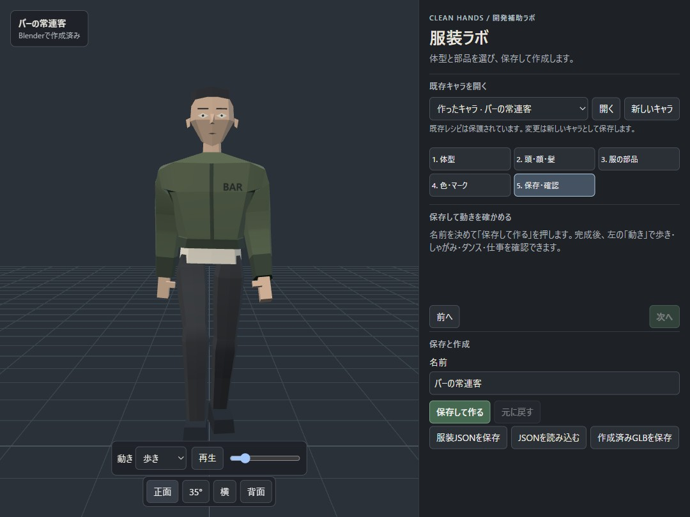
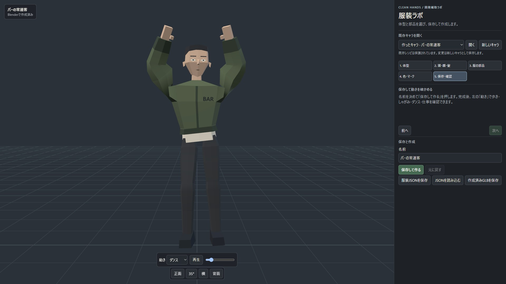
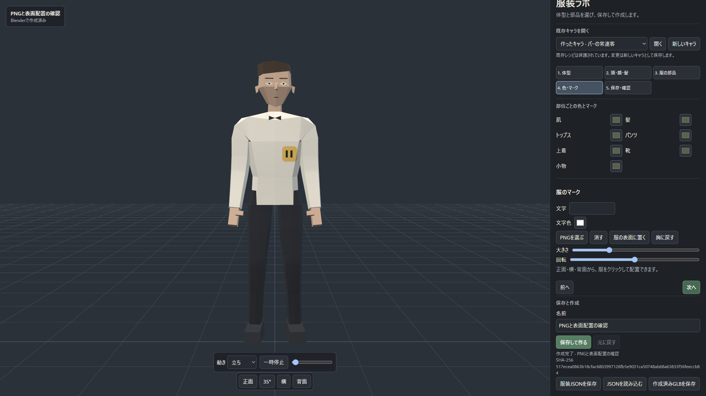
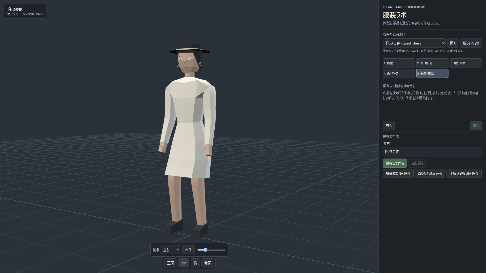
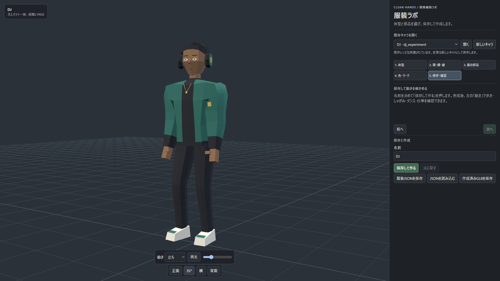

# 服装の作り直し：段階4 ラボ

## 結果

**できた。ラボで新規キャラを保存し、BlenderのGLBを表示できる。** 既存38件を開く実機試験、操作APIでの保存・生成、文字/PNGマーク、4種類の動作、2画面サイズの確認を行った。

**8795への反映には、このブランチの取り込みとサーバーの再起動が必要。再起動していない。** Claudeの確認後に実施する。8795〜8798はPID16224のまま継続稼働し、今回の確認には別サーバー8891だけを使用した。

- 作業場所：`outputs/m5-outfit-overhaul`、ブランチ `outfit/overhaul`、開始コミット `91dd1f5`。
- 時刻：開始は `stage4-before.json` のstartedAt、終了は末尾。
- ゲームのGLB読み先、embed-npcs.mjs、既存の38レシピと32候補GLBは変更していない。push・mainへのマージもしていない。
- 確認ページ：`http://127.0.0.1:8891/outfit-lab`。
- 最後の専用形状の検証追加後、自分用プレビューの再起動と別ポート起動は自動承認レビューで拒否された（理由表示：blocked by policy）。8891は動作試験時のサービスを継続している。最終サービスソースは単体試験で確認した。

## 作った機能

### レシピの編集と表示

体型→頭/顔/髪→トップス/パンツ/上着/靴/小物/模様→役割ごとの色/マーク→保存・確認の順で操作する。既存の色・文字・左右2列の構成を引き継いだ。長い編集欄は右側のパネル内をスクロールする。

部品の互換体型・色の役割・許可されたパラメーターをBlenderの登録表から `catalog/catalog.json` へ出力し、画面とサーバーで共有する。非対応の部品は選択肢へ出さない。女性の頭・顔と男性用の上着/飾り等も分けている。プール客の体型専用の胴・脚・飾りと筋肉質女性の髪も体型に合わせて制限する。DJの専用処理で一体化された髪・衣服・飾りはそのまま表示し、単独で交換できると誤表示しない。

画面上の変更は「編集中」と示し、保存してBlenderで作った後のGLBを最終プレビューにする。ブラウザのGLBExporterを最終生成には使わない。肌・髪・トップス・パンツ・上着・靴・小物は別の色として保存し、新規モデルの面の役割ごとに材質を割り当てる。体型違いの肌パレット再割当ても扱う。

既存38件は段階3の候補GLB（固定5件は元GLB）を表示し、「元とバイト一致・段階3 PASS」を示す。固定資産とaliasは編集不可。生成レシピの編集も元へ上書きせず、新しいIDで保存する。

`window.__outfitLab` のgetRecipe/setRecipe/setPart/setMark/getInventory/findInventory/listParts/exportGLBを保持し、loadRecipe/setBody/selectPart/saveAndBuild/setMotion/status/readyを追加した。旧version:1の服装JSONは新形式へ移行でき、旧setPartの部位名・襟/丈指定も受け付ける。GLBの取得はBlenderで作成済みのものに限る。

### 保存とBlenderジョブ

`tools/outfit_service.py` を共有サーバーのPlaytestへ接続した。確認用の `tools/outfit-preview.py` は8890〜8899だけを使い、既存サーバーを起動・停止しない。

|API|内容|
|---|---|
|GET /api/outfit/catalog|部品庫、既存レシピ、作成済み新規レシピ、段階3の結果|
|GET /api/outfit/recipes/:id|指定IDのレシピ|
|GET /api/outfit/models/:id|指定IDのGLB|
|POST /api/outfit/jobs|新しいレシピを保存し、生成ジョブを投入|
|GET /api/outfit/jobs/:id|queued/running/complete/errorと結果|

localhostの接続・Host・Originだけを認め、保存は専用ヘッダー `X-Outfit-Lab: 1` を要求する。JSONの部品・体型・パラメーター・色・PNGを検証し、外部パス/コマンドは使用しない。IDはサーバーがUUIDから割り当てる。Blenderはshell=Falseの固定引数で起動し、同時実行1、待ちを含め3件まで、1件120秒まで。ブラウザのリクエスト中に生成完了を待つ方式にはしていない。

新規レシピは `assets/characters/recipes/new/`、GLBとmark.png/build.jsonは `assets/characters/models/new/<id>/`。各保存は別IDなので、既存38件や前の版を書き換えない。失敗もジョブ状態へ返す。

### マークと動作

文字/PNG、色、サイズ、回転、胸位置へのリセット、正面・横・背面からの表面クリック配置を保持した。PNGは256 KB・2048px以内。画面でマーク画像を作り、Blenderでは対象服の面をクリップして、補間した骨ウェイトを持つMark_Surfaceを生成する。GLBへ画像も含めて保存する。

動作はアニメーションラボのCLIPSとposeMotionPreviewをそのまま使う。歩き・しゃがみ・ダンス・仕事を選べて、停止と時刻指定もできる。

### 従来の上着

元のagent07-jacketのソース・blend・GLBを `assets/outfits/agent07-jacket/` にコピーし、外部フォルダに依存しない2段階の再生成を実行した。元ファイルは変更していない。

フィールド/フライト各4変種（襟・丈）、ブレザー、従来のトップス/パンツ/小物を部品庫へ入れた。未調整の女性/プール体型には出さない。元の体型に合うキャスト男性に限定するのが無難と判断した。

新規の閉じたフライトジャケットでは、内側のシャツの隠れる上部を省き、見える裾を残す。ダンスで内側袖が突き抜ける重なりを避けるため。新規生成だけの処理で、既存モデルには適用しない。

## 操作だけで作ったキャラと画像

「バーの常連客」は体型・部品・色・文字マーク・保存ボタンをラボで操作して生成した。最終版は以下。

- ID：`new_9d0e28b709704d9fa1da4227c3e324e0`
- GLB：`assets/characters/models/new/new_9d0e28b709704d9fa1da4227c3e324e0/new_9d0e28b709704d9fa1da4227c3e324e0.glb`
- SHA-256：`cb81f7b3a6df6f5b77add42bd4a84c3735e508ea2b1d8bdba0e3e6c5616d5cb4`
- 共通男性、半袖シャツ、スラックス、フライトジャケット、部位別の色、胸のBAR文字。





歩きとダンスの採取フレームで、袖の重なり調整後に服の裂け・内側袖の突き抜けがないことを画像で確認した。しゃがみ/仕事も `new-crouch-1920.jpg` / `new-work-1920.jpg` に保存。任意の全組み合わせ・全動作時刻での無干渉を保証したという意味ではない。

PNGはラボのファイル選択から読み、服をクリックして配置し、別キャラ `new_1afa39789f20401799d513b7910780e3` に保存した。`stage4-png-test.json` に配置点/法線/サイズと保存後の状態がある。



既存キャラの例。表示しているGLBは段階3のバイト一致結果と対応する。





筋肉質のプール客とAgent 47も `existing-pool_guest_strong.jpg` / `existing-agent47.jpg` に記録した。

## 検証結果

|検査|結果|
|---|---|
|実ブラウザで全38件をloadRecipe|成功。stage4-browser-api-tests.jsonに全IDを記録|
|window APIの読み込み/選択/保存/生成/取得|成功。不適合部品は拒否。app/scripts/outfit-browser-check.mjsが実際のwindow.__outfitLabだけを使って試験|
|PNG読込/表面クリック/Blender保存|成功。画像と配置データを保存|
|1080×810 / 1920×1080|文書とパネルの横はみ出し0。重なり/切れを画像で確認。stage4-layout-tests.json|
|新規GLB3個の公式Khronos Validator|全てエラー0・警告0。stage4-gltf-validation.json|
|HTTPでの拒否確認|ヘッダー無し403、外部Origin403、固定資産の保存400、不正Host403。stage4-http-tests.json|
|Pythonサービス単体試験|5件成功。型/体型/色/PNG/パス/コマンド/Origin、プール専用形状を確認|
|Blenderのレシピ試験|5件成功。既存38件の登録と固定/aliasの保護を確認|
|服装ラボの部品/互換性/旧形式/APIヘッダー試験|5件成功。プール専用形状とDJ部品の制限も確認|
|npm run spec|終了0。型・仕様生成と試験成功。ℹ tests 602 / ℹ pass 600 / ℹ fail 0 / ℹ todo 2|
|npm run build:all|終了0。全11対象成功|
|verify_all.py|終了0。37実体すべてバイト一致、数値一致のみ0、FAIL0|
|開始時の保護記録と照合|外部3フォルダ772ファイル、既存レシピ/モデル/build.json計102ファイルとも変更0|

検証器は現在の段階の保護manifestを選べるようにした。段階3の補助チェックは、当時未コミットだった確認日時ファイルのSHAを固定しており、今回の開始状態とは異なっていた。最初の実行では37実体は全てバイト一致しながら、その補助チェックだけFAILになった。現在の段階4開始記録で保護する方式にし、デフォルトも段階4の記録を使う。元GLBの基準SHA、比較条件、許容差は変えていない。過去の結果JSONも書き換えない。

## 再実行

```powershell
# 既存37実体と保護ファイル
python assets/characters/source/verify_all.py
# 明示する場合
python assets/characters/source/verify_all.py --protection-snapshot stage4-before.json --report stage4-existing-verification.json
# 自分用のサーバー。8795〜8798は再起動しない
python tools/outfit-preview.py --port 8891
# 部品庫の定義を更新した場合
& 'C:/Program Files/Blender Foundation/Blender 4.2/blender.exe' -b --python-exit-code 1 -P assets/characters/source/export_catalog.py
python tools/test_outfit_service.py
npm --prefix app run spec
npm --prefix app run build:all
```

## 失敗した所・決めた所

- 最初のジョブで、ヘルパーのimportがsys.path設定より前にあり失敗した。順序を修正し、再試行で生成を確認した。失敗状態はジョブへ返る。
- 文字入力はchangeだけでなくinputで反映し、入力中に編集欄を作り直さないよう修正した。
- フライト上着と内側袖の重なりは新規用の隠面処理で解消した。既存部品の原本は変更していない。
- 画像の取得は描画画面の見かけの寸法に依存せず、CDPで指定サイズを明示して保存した。
- 保存は新しいIDを毎回作る方式。調整途中の版とAPI/PNG試験の新規キャラもnew/内へ残している。既存38件から分離されている。
- 役割の色変更や任意の組み合わせの完全な衣服干渉判定は行わない。互換体型の絞り込みと、生成後の動作プレビューで確認する。

## 変更ファイル

- ラボ：outfit-lab.ts / outfit-lab.css、追加outfit-recipes.ts、outfit-recipes.test.ts、outfit-browser-check.mjs。
- 生成：build_recipe.py、new_character_effects.py、export_catalog.py、catalog/catalog.json、verify_all.py。
- サーバー：tools/dev-servers.py、outfit_service.py、outfit-preview.py、test_outfit_service.py。
- 従来部品：assets/outfits/agent07-jacket/、app/scripts/build-repository-outfit-catalog.py。
- 新規キャラ：assets/characters/recipes/new/ と models/new/。
- 調査記録：stage4-*のmanifest・結果・ログ・画像、本報告。

ゲームのデータや画面のソースは変更していない。全体ビルドのbuild-info.jsonは、このworktreeのHEADの内容へ戻した。

終了：2026-11-12 12:02:02 JST。段階4の実装・検証・報告を完了し、ここで停止。8795の再起動とゲームのGLB差し替えは行わない。
