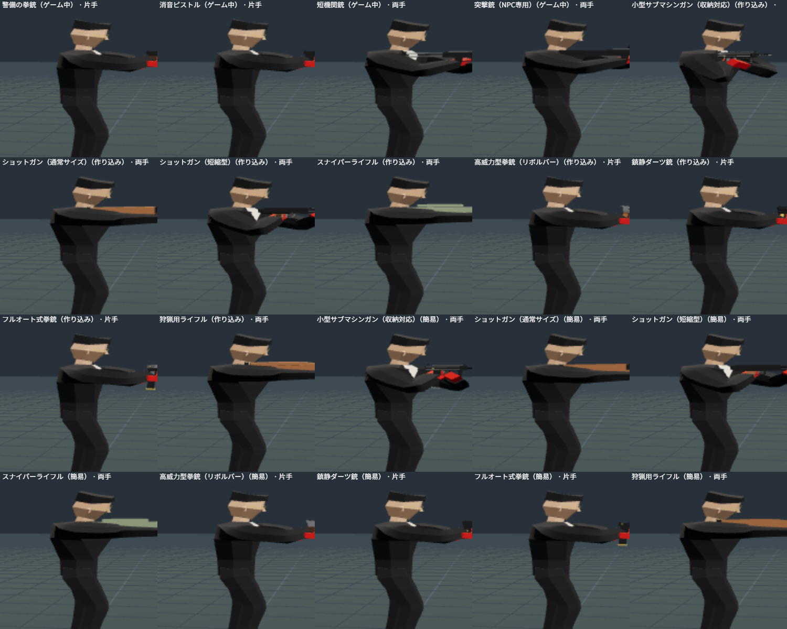

# 2026-11-06 の作業（自分の判断で進めた分）

Claude が書いた。資料がそろったので、次の3つを選んで進めた。

## 1. やり残しの片付け
- `assets/guns-simple/overview.jpg` を、直したリボルバーで作り直した。
- 194項目のチェックリストに、簡易版（`assets/guns-simple`）があることを書き足した。
- 取り消された指示で作りかけた拳銃2丁の作り込み版（`pistol_guard_hd` など）は、`assets/guns/unused-reverted/` に移した。作った設計のコードは巻き戻しで消えている。ゲームとラボでは使わない。

## 2. 銃を確かめるラボ
- モーション実験ステージの「銃」の欄で、全部の銃のモデルを選べるようにした。全部で20丁。
  - ゲーム中の4丁
  - 作り込み版の8丁
  - 簡易版の8丁
- 戦闘モーション（構える、撃つ、弾を込める など）で、持ち方を見比べられる。
- 埋め込みは `app/scripts/embed-guns.mjs` → `app/src/gun-data.ts`（ラボだけが読む。ゲームは読まない）。
- **見つけて直したこと**：銃床の印（`STOCK`）のない両手持ちの銃（小型SMG、短縮型ショットガン）で、構えの関数が止まっていた。共通の `combat-runtime.ts` の `prepareWeapon` に、印がない時の代わりの位置を足した。今までの銃は、すべて印があるので変わらない。

## 3. 鎮静ダーツ銃をゲームに入れた
HITMAN の代表的な「殺さない」手段。クラブの準備画面の「拳銃」で選べる。

- 当たった人は騒がずに2.5秒歩き、それから眠る。
  - 眠った状態は、背後から気絶させた時と同じ。殺しにはならないので、サイレントアサシンの点に響かない。
- 1発ずつ装填し、予備は4発。音は小さい。
- 違法な拳銃なので、入口の身体検査で止められる。
- 見られて構えれば、ほかの銃と同じく撃ち合いになる。
- モデルは簡易版の鎮静ダーツ銃で、ゲームのほかの銃と同じ細かさ。
- 場所：
  - `weapons.json` の `tranq_pistol`
  - `combat.ts`（`sedative`、`sedating`）
  - `kills.ts`（`markUnconscious`）
  - `combat-view.ts`
  - `embed-combat.mjs`
  - `build-club-source.py`（準備画面の選択肢）
- 確かめたこと：
  - AI 実験ステージに「鎮静ダーツで眠らせる」を足した（合格。当てて1秒後はまだ歩き、2.5秒で眠り、離れた警備は気づかない）。
  - 武器の表の試験を1件足した。
  - 試験は379件すべて通過。
  - クラブで選んで構えられることを、ブラウザで確かめた。
- ホテルとパーティーのページも組み立て直した（`combat.ts` は共有）。ただし、そちらの準備画面には選択肢を足していない。

## 次にやるとよいこと（案）
1. 新しい道具・武器をクラブに置く（ハンマー、バール、包丁、フライパン、レンガ）。置かないと、持ち物・投げる・近接の仕組みが遊べない。
2. 投げる（コイン以外の小物を投げる、投げて気絶させる）と、近接武器で殴る・刺す動き。
3. 新しい銃のうち、ゲームで意味があるもの（スナイパーライフルの持ち込みとケースなど）を入れる。
4. 座る仕草（クラブのラウンジ）。
